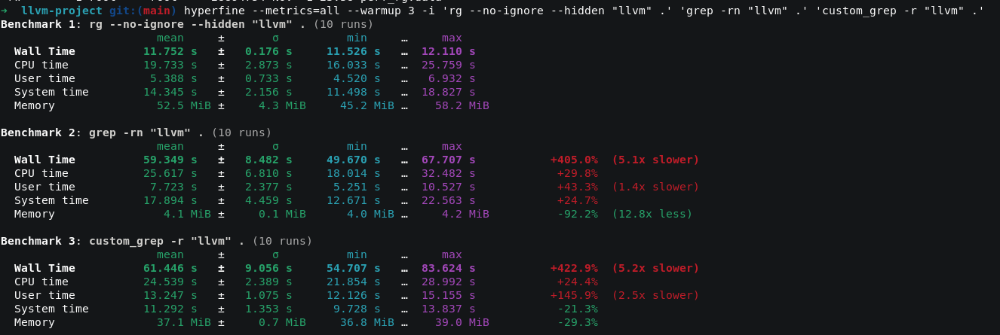

# Analyse of data

An using **hyperfine** we will have this informations:

First of all I will begin by optimize basics things like:
 - limited calls to syscall 
 - cleaning code

The command **strace** is for detect syscall

