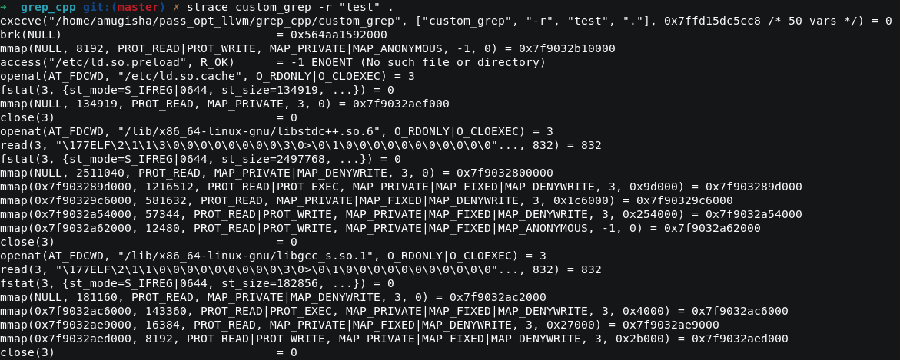

# Analyse of data

In this version I edit the code for to have only one open function. With that base we will check performance.

```**perf record -g -o perf.data -- custom_grep -r "llvm" .**```
This command record command's preformance given to perf.

An using ```**perf report -i perf_custom.data**``` we could check what function cost more of time in CPU:


And also compare with previous custom_grep:


Now we can see more memory is used with the second custom_grep although rdir take less time of CPU. There are a lot of call to read and **strace** can confirm that, if we remove ifstream (open) and read, we can gain some perf.

After change ifstream by open and read by mmap for avoid call system and fusioned the binary detection and pattern's researching, normally, we have gain perf everywhere except in memory. It's normaly, mmap map all file.

**Starce** revealed almost absolute absence of read, but there are again some read.
. 

For more anderstanding how a executable file work we will, examine each line.

At execution of a program on kernel linux, a syscall function `execve` is call for replace current procces by his child process but no edit the PID, it's mean that except for process ID, memory, code, stack, enveronnment, variables and arguments are replace.

Next, `brk(NULL)` command is the process asking where **HEAP memory** end. `brk()` and `sbrk()` change the location of the *program break*, which defines the end of the process's data segment. The program break is the first location after the end of the uninitialized data segment.
It's generaly first command of programs after `execve`, because they use `malloc()` right away. or a library call they make uses `malloc()`.

Than, the dynamic linker of linux kernel "ld-linux-archi-.so" is directly call, this command can fine him:

```readelf -l custom_grep | grep interpreter```

His mission is


This benchmark confirm the gains in system time and CUP time and lot of use of RAM memory.
We can profile for to have a better view of where we should be focus.

This command will be profile on graph's form, the functions call:

```perf record -F 4000 -g --call-graph fp -o perf_custom_grep.data -- custom_grep -r "llvm" .```

> - --call-graph: *Setup and enable call-graph (stack chain/backtrace) recording, implies -g. Default is "fp" (for user space). When "fp" recording is used, perf tries to save stack entries up to the number specified in sysctl.kernel.perf_event_max_stack by default.  User can change the number by passing it after comma like "--call-graph fp,32"*
> - -F: *Profile at this frequency. Use max to use the currently maximum allowed frequency, i.e. the value in the kernel.perf_event_max_sample_rate sysctl. Will throttle down to the currently maximum allowed frequency.*

This command convert .data file of perf record int to data readable by tools of Flame Graph:

```
perf script -i ~/pass_opt_llvm/grep_cpp/perf_custom_grep_no_read.data > custom_grep_no_read.perf
```

Use Flame Graph can help to visualize the time take by a function and children functions on the stack.
Clone Flame Graph repository, than at inside, this command: ```./stackcollapse-perf.pl custom_grep_no_read.perf > out.folded``` create a file **.perf** in to .floded, used by Flame Graph for return a file et svg format realy well read by your browser.

```./flamegraph.pl out.folded > custom_grep_no_read.svg```

This is hte Flame Graph of custom grep without read:

