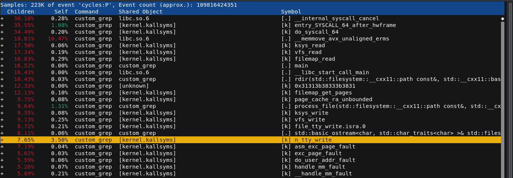
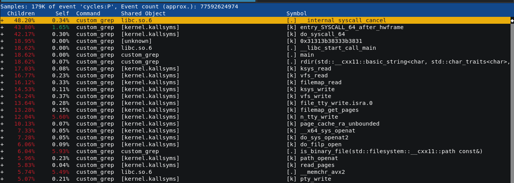
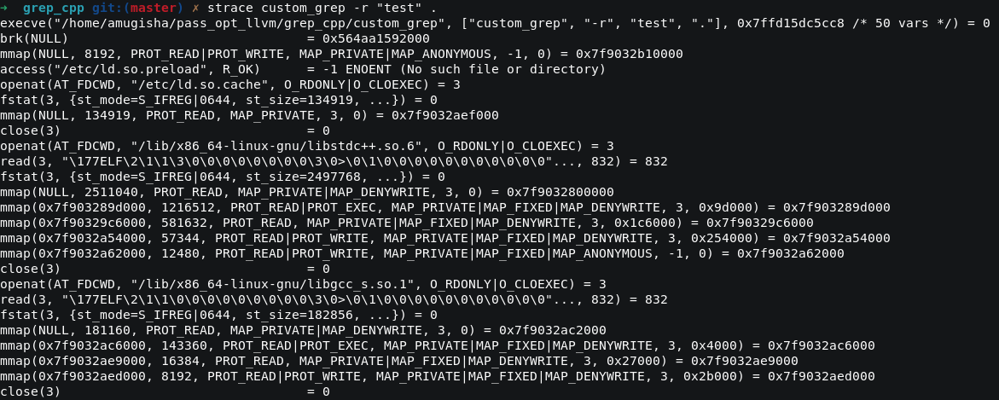
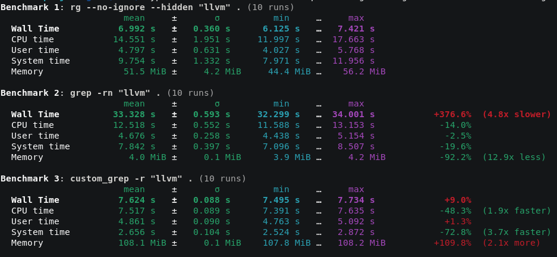
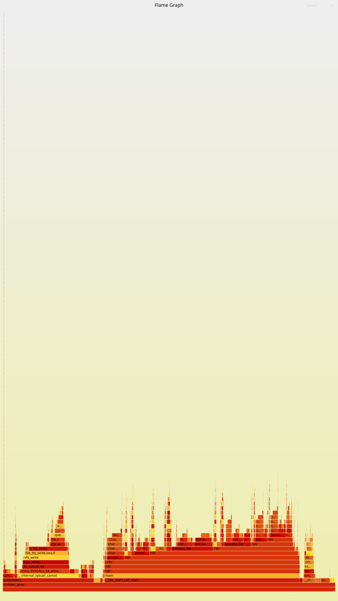

# Analyse of data

In this version I edit the code for to have only one open function. With that base we will check performance.

```**perf record -g -o perf.data -- custom_grep -r "llvm" .**```
This command record command's preformance given to perf.

An using ```**perf report -i perf_custom.data**``` we could check what function cost more of time in CPU:


And also compare with previous custom_grep:


Now we can see more memory is used with the second custom_grep although rdir take less time of CPU. There are a lot of call to read and **strace** can confirm that, if we remove ifstream (open) and read, we can gain some perf.

After change ifstream by open and read by mmap for avoid call system and fusioned the binary detection and pattern's researching, normally, we have gain perf everywhere except in memory. It's normaly, mmap map all file.

**Starce** revealed almost absolute absence of read, but there are again some read.
. 

For more anderstanding how a executable file work we will, examine each line.

## Linux dynamic loader / linker

At execution of a program on kernel linux, a syscall function `execve` is call for replace current procces by his child process but no edit the PID, it's mean that except for process ID, memory, code, stack, enveronnment, variables and arguments are replace.

Next, `brk(NULL)` command is the process asking where **HEAP memory** end. `brk()` and `sbrk()` change the location of the *program break*, which defines the end of the process's data segment. The program break is the first location after the end of the uninitialized data segment. brk() sets the end of the data segment to the value specified by addr, if addr is NULL, brk return the value of program break. sbrk() increments the program's data space by increment bytes. Calling sbrk() with an increment of 0 can be used to find the current location of the program break.

It's generaly first command of programs after `execve`, because they use `malloc()` right away, or a library call they make uses `malloc() or mmap`.

Than, the dynamic linker / loader of linux kernel "ld-linux.so*" is directly call, this command can fine him:

```readelf -l custom_grep | grep interpreter```

It can be run either indirectly by running some dynamically linked program or shared object (in which case no command-line options to the dynamic linker can be passed and, in the ELF case, the dynamic linker which is stored in the .interp section of the program is executed) or directly by running:
> /lib/ld-linux.so.*  [OPTIONS] [PROGRAM [ARGUMENTS]]

### Description

The programs ld.so and ld-linux.so* find and load the shared objects (shared libraries) needed by a program, prepare the program to run,  and then run it. Linux binaries require dynamic linking (linking at run time) unless the -static option was given to ld (GNU linker) during compilation.
The program ld.so handles a.out binaries, a binary format used long ago. The program ld-linux.so* (/lib/ld-linux.so.1 for libc5, /lib/ld-linux.so.2 for glibc2) handles binaries that are in the more modern ELF format. Both programs have the same behavior.

For allocate virtual memory, there is `mmap()` system function.

### mmap function

mmap() creates a new mapping in the virtual address space of the calling process. The starting address for the new mapping is specified in addr argument. The length argument specifies the length of the mapping (which must be greaterthan 0).
If addr is NULL, then the kernel chooses the (page-aligned) address at which to create the mapping, this is the most portable method of creating a new mapping. If addr is not NULL, then the kernel takes it as a hint about where to place the mapping, on Linux, the kernel will pick a nearby page boundary.

The contents of a file mapping (as opposed to an anonymous mapping), are initialized using length bytes starting at offset offset in the file (or other object) referred to by the file descriptor fd.
After the mmap() call has returned, the file descriptor, fd, can be closed immediately without invalidating the mapping.

The prot argument describes the desired memory protection of the mapping (and must not conflict with the open mode of the file). It is either PROT_NONE or the bitwise OR of one or more of the following flags:

 - PROT_EXEC:  Pages may be executed.
 - PROT_READ:  Pages may be read.
 - PROT_WRITE: Pages may be written.
 - PROT_NONE:  Pages may not be accessed.

The flags argument determines whether updates to the mapping are visible to other processes mapping the same region, and whether updates are carried through to the underlying file. This behavior is determined by including exactly one of the following values in flags:

 - MAP_SHARED: Share this mapping. Updates to the mapping are visible to other processes mapping the same region, and (in the case of file-backed mappings) are carried through to the underlying file. (To precisely control when updates are carried through to the underlying  file requires the use of msync(2).)
 - MAP_SHARED_VALIDATE (since Linux 4.15): This flag provides the same behavior as MAP_SHARED except that MAP_SHARED mappings ignore unknown flags in flags. By contrast, when creating a mapping using MAP_SHARED_VALIDATE, the kernel verifies all passed flags are known and fails the mapping with the error EOP‐ NOTSUPP for unknown flags.
 - MAP_PRIVATE: Create a private copy-on-write mapping. Updates to the mapping are not visible to other processes mapping the same file, and are not carried through to the underlying file. It is unspecified whether changes made to the file after the mmap() call are visible in the mapped region.

In addition, zero or more of the following values can be ored in flags

 - MAP_ANONYMOUS: The mapping is not backed by any file, its contents are initialized to zero.  The fd argument is ignored, however, some implementations require fd to be -1 if MAP_ANONYMOUS (or MAP_ANON) is specified, and portable applications should ensure this. The offset argument should be zero.
> See more flags [lman mmap() system function](https://man7.org/linux/man-pages/man2/mmap.2.html).

So it's ld.linux.so who call mmap at the next line for allocate 2 pages of 4 bytes (4096 bits) with the aim of prepare memory space needed for program run time.
Actually, this space memory, where location has be determinate by kernel, is readable and writable. This memory is not connect with any file descriptor and is not accessible to other process.

After that, ld-linux.so will relove shared object dependencies, the dynamic linker first research if a shared object pathname containing slashes was specified at link time. If it's don't, it will searched in several places if instructions of loading are needed, following this order:

 - the directories specified in the DT_RPATH dynamic section attribute of the binary
 - the environment variable LD_LIBRARY_PATH, unless the executable is being run in secure-execution mode, in which case this variable is ignored.
 - the directories specified in the DT_RUNPATH dynamic section attribute of the binary if present.
 - the cache file /etc/ld.so.cache, which contains a compiled list of candidate shared objects previously found in the augmented library path.
 - the default path /lib, and then /usr/lib.

Various environment variables influence the operation of the dynamic linker.

<ins>Secure-execution mode</ins>
For security reasons, if the dynamic linker determines that a binary should be run in secure-execution mode, the effects of some environment variables are voided or modified, and furthermore those environment variables are stripped from the environment, so that the program does not even see the definitions.
A binary is executed in secure-execution mode if the AT_SECURE entry in the auxiliary vector has a nonzero value. This entry may have a nonzero value for various reasons, including:

 - The process's real and effective user IDs differ, or the real and effective group IDs differ. This typically occurs as a result of executing a set-user-ID or set-group-ID program.
 - A process with a non-root user ID executed a binary that conferred capabilities to the process.
 - A nonzero value may have been set by a Linux Security Module.

<ins>Environment variables</ins>

Among the more important environment variables are the following:

 - LD_ASSUME_KERNEL (from glibc 2.2.3 to glibc 2.36): Each shared object can inform the dynamic linker of the minimum kernel ABI version that it requires. (This requirement is encoded in an ELF note section that is viewable via readelf -n as a section labeled NT_GNU_ABI_TAG.) At run time, the dynamic linker determines the ABI version  of the running kernel and will reject loading shared objects that specify minimum ABI versions that exceed that ABI version.
 - LD_BIND_NOW (since glibc 2.1.1): If set to a nonempty string, causes the dynamic linker to resolve all symbols at program startup instead of deferring function call resolution to the point when they are first referenced. This is useful when using a debugger.
 - LD_LIBRARY_PATH: A list of directories in which to search for ELF libraries at execution time.
 - LD_PRELOAD: A list of additional, user-specified, ELF shared objects to be loaded before all others. This feature can be used to selectively override functions in other shared objects. There are various methods of specifying libraries to be preloaded, and these are handled in the following order:
    - The LD_PRELOAD environment variable.
    - The --preload command-line option when invoking the dynamic linker directly.
    - The /etc/ld.so.preload file (described below).

And it's this last method who is display by strace at the next line with access function.

## Access function

Access system function checks whether the calling process can access the file pathname.
The mode specifies the accessibility check(s) to be performed, and is either the value F_OK, or a mask consisting of the bitwise OR of one or more of R_OK, W_OK, and X_OK. F_OK tests for the existence of the file. R_OK, W_OK, and X_OK test whether the file exists and grants read, write, and execute permissions, respectively.

This line shows us than access search to know if "/etc/ld.so.preload" exist and is readable, the return indicate than this file doesn't exist.

The others lines before my calls system are there for loading libraries, mapping functions, randoming address and prepere memory space.



This benchmark confirm the gains in system time and CUP time and lot of use of RAM memory.
It's due to mmap function, later will reduce use of RAM.

We can profile for to have a better view of where we should be focus.

This command will be profile on graph's form, the functions call:

```perf record -F 4000 -g --call-graph fp -o perf_custom_grep.data -- custom_grep -r "llvm" .```

> - --call-graph: *Setup and enable call-graph (stack chain/backtrace) recording, implies -g. Default is "fp" (for user space). When "fp" recording is used, perf tries to save stack entries up to the number specified in sysctl.kernel.perf_event_max_stack by default.  User can change the number by passing it after comma like "--call-graph fp,32"*
> - -F: *Profile at this frequency. Use max to use the currently maximum allowed frequency, i.e. the value in the kernel.perf_event_max_sample_rate sysctl. Will throttle down to the currently maximum allowed frequency.*

This command convert .data file of perf record int to data readable by tools of Flame Graph:

```
perf script -i ~/pass_opt_llvm/grep_cpp/perf_custom_grep_no_read.data > custom_grep_no_read.perf
```

Use Flame Graph can help to visualize the time take by a function and children functions on the stack.
Clone Flame Graph repository, than at inside, this command: ```./stackcollapse-perf.pl custom_grep_no_read.perf > out.folded``` create a file **.perf** in to .floded, used by Flame Graph for return a file et svg format realy well read by your browser.

```./flamegraph.pl out.folded > custom_grep_no_read.svg```

This is hte Flame Graph of custom grep without read:

