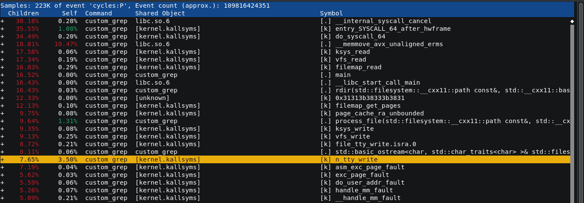
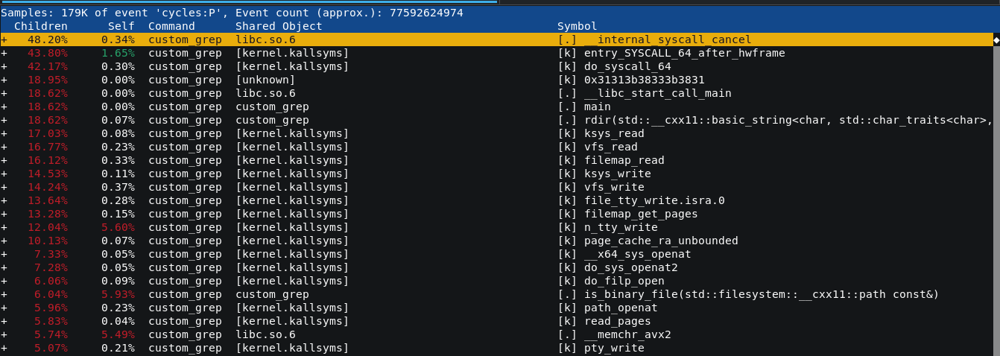
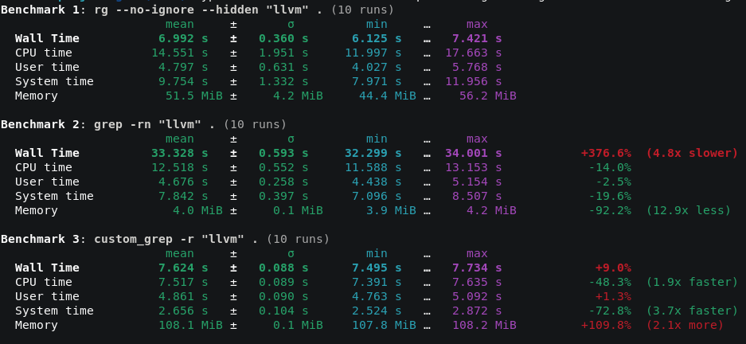
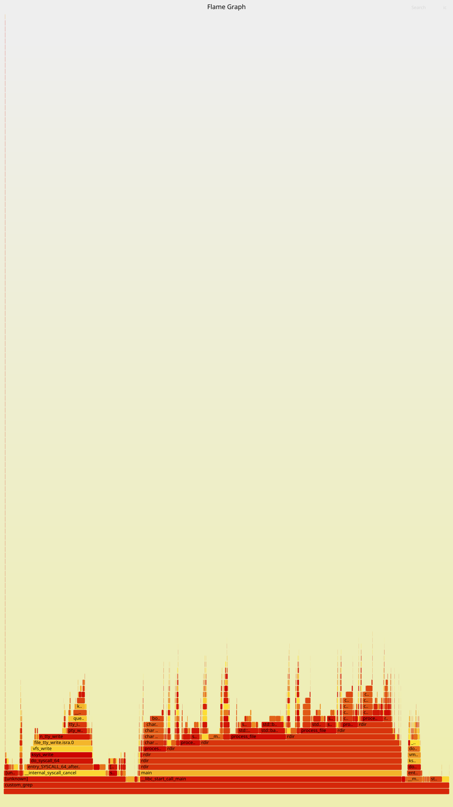

# Analyse of data

In this version I edit the code for to have only one open function. With that base we will check performance.

```**perf record -g -o perf_custom_grep_1open.data -- custom_grep -r "llvm" .**```
This command record command's preformance given to perf.

An using ```**perf report -i perf_custom.data**``` we could check what function cost more of time in CPU:


And also compare with previous custom_grep:


Now we can see more memory is used with the second custom_grep although rdir take less time of CPU. There are a lot of call to read and **strace** can confirm that, if we remove ifstream (open) and read, we can gain some perf.

After change ifstream by open and read by mmap for avoid call system and fusioned the binary detection and pattern's researching, normally, we have gain perf everywhere except in memory. It's normaly, mmap map all file.



This benchmark confirm the gains in system time and CUP time and lot of use of RAM memory.
We can profile for to have a better view of where we should be focus.

This command will be profile on graph's form, the functions call:
```perf record -F 4000 -g --call-graph fp -o perf_custom_grep.data -- custom_grep -r "llvm" .```

This command convert .data file of perf record int to data readable by tools of Flame Graph:
```
perf script -i ~/pass_opt_llvm/grep_cpp/perf_custom_grep_no_read.data > custom_grep_no_read.perf
```

Use Flame Graph can help to visualize the time take by a function and children functions on the stack.
Clone Flame Graph repository, than at inside, this command: ```./stackcollapse-perf.pl custom_grep_no_read.perf > out.folded``` create a file **.perf** in to .floded, used by Flame Graph for return a file et svg format realy well read by your browser.

```./flamegraph.pl out.folded > custom_grep_no_read.svg```

This is hte Flame Graph of custom grep without read:

